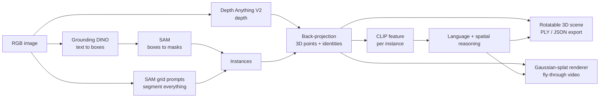

# Language-Guided 3D Instance Segmentation, Retrieval and Gaussian-Splat View Synthesis

From **one RGB image**: instance masks -> monocular depth -> coloured 3D point cloud with object identities -> rotatable 3D view -> natural-language and spatial queries highlighted in 3D -> camera fly-through rendered with Gaussian splats. Runs on an Apple Silicon Mac (PyTorch MPS) with a Gradio UI.

> Deep-learning course project. It **composes pretrained models** (Grounding DINO, SAM, Depth Anything V2, CLIP); nothing is trained here. The contributions are the 3D lifting, the language/spatial-reasoning layer, the splat renderer and the evaluation tooling. See [What is and is not from the papers](#what-is-and-is-not-from-the-papers).

<!-- After you add screenshots to docs/, uncomment these lines:


-->

## Contents
1. [Features](#features) · 2. [Pipeline](#pipeline) · 3. [Installation](#installation) · 4. [Quick start](#quick-start) · 5. [Query language](#query-language) · 6. [Evaluation](#evaluation) · 7. [Results](#results) · 8. [Repository layout](#repository-layout) · 9. [Limitations](#limitations) · 10. [Troubleshooting](#troubleshooting) · 11. [Tests](#tests) · 12. [Citations](#citations-and-acknowledgements) · 13. [Licence](#licence)

## Features
- **Instance masks, not boxes:** Grounding DINO (text -> boxes) + SAM (boxes -> masks), plus a SAM point-grid "segment everything" pass so objects outside your typed vocabulary are also instances (named by CLIP zero-shot).
- **Depth and 3D lifting:** Depth Anything V2 (relative, or metric indoor/outdoor) back-projected with a pinhole camera model into a coloured point cloud; per-instance outlier trimming, axis-aligned and PCA 9-DoF boxes.
- **Rotatable 3D scene** (Plotly) coloured by instance identity or true colour; export to **PLY** (`x y z r g b instance`) and **JSON**.
- **Language-guided retrieval:** CLIP features per instance with a LERF-style relevancy score, combined with detector labels.
- **Spatial reasoning:** left/right/front/behind/above/below/on top of/near/between, superlatives (closest, largest...), counting and distances, evaluated geometrically on 3D boxes.
- **Gaussian-splat view synthesis:** one Gaussian per pixel, soft depth-sorted rasteriser (NumPy, runs on any Mac), orbit / dolly / sway camera paths -> mp4.
- **Evaluation tooling:** NYU Depth V2 metrics, a click-labelled retrieval benchmark with confidence intervals, CPU-vs-MPS benchmark, auto-generated result tables.

## Pipeline


| Stage | Code | What it does |
|---|---|---|
| Detection | `seg3d.py: detect` | `chair, table` -> `chair. table.`; boxes whose tokens match the words |
| Instance masks | `segment`, `segment_grid` | SAM box prompts; point-grid prompts + mask-IoU NMS; overlaps with detector masks removed |
| Depth | `estimate_depth`, `geom3d.disparity_to_depth` | relative disparity -> depth (GT scale/shift fit in evaluation, assumed 0.5-8 m range in demo) or metric depth |
| Lifting | `lift`, `geom3d.backproject` | `X=(u-cx)Z/fx, Y=(v-cy)Z/fy, Z=depth`; 2-98 percentile trim; boxes |
| Features | `semantic.py` | CLIP embedding of each masked crop; relevancy vs canonical phrases; zero-shot names for free segments |
| Reasoning | `reasoning.py` | rule-based parser + geometric predicates on 3D boxes |
| View synthesis | `geom3d.render_splats` | per-pixel Gaussians, Gaussian-weighted soft z-buffer, hole filling |

## What is and is not from the papers
| Paper | Used here | Not done here |
|---|---|---|
| SAM (Kirillov et al., ICCV 2023) | box and point prompts | no fine-tuning |
| Depth Anything / V2 (Yang et al.) | monocular depth (V2 checkpoints) | no training |
| Splatter Image (Szymanowicz et al., CVPR 2024) | the *representation*: one 3D Gaussian per pixel | their learned network (trained on object-centric data, CUDA rasteriser). Gaussians are set analytically from depth; renderer is our own NumPy code |
| LERF (Kerr et al., ICCV 2023) | the *relevancy score* and idea of lifting CLIP features | no NeRF, no multi-view optimisation; features are per segment, not a continuous field |
| Open3DIS (Nguyen et al., CVPR 2024) | paradigm: 2D foundation-model masks + CLIP lifted to 3D | works on 3D scans; this uses one view |
| Grounding DINO, CLIP | components | - |

## Installation
Requires an Apple Silicon Mac for the MPS speed-up (it also runs on CPU). Developed and run by the author in a Python 3.14 virtual environment on macOS; other Python versions are untested.
```bash
git clone https://github.com/<your-username>/<repo-name>.git
cd <repo-name>
python3 -m venv .venv && source .venv/bin/activate
pip install --upgrade pip && pip install -r requirements.txt
python -c "import torch; print(torch.backends.mps.is_available())"   # True on Apple Silicon
```
The first run downloads about 2 GB of model weights from Hugging Face (Grounding DINO tiny, SAM base, Depth Anything V2 Small, CLIP B/32) into your Hugging Face cache, not into this repository.

## Quick start
```bash
python tests/test_core.py                                # model-free tests, seconds
python prepare_samples.py "/path/to/your/photos"          # resize/rotate into samples/
python seg3d.py samples/room1.jpg --vocab "chair, table, sofa"   # CLI check -> results/overlay.png, results/scene.ply
python app.py                                             # UI at http://127.0.0.1:7860
```
**UI tabs**
1. **Scene** - upload a photo, *Build 3D scene*, rotate the point cloud (instance colours or true colour).
2. **Ask the scene** - type a query; the result is red in 2D and 3D, anchors cyan.
3. **Novel views (Gaussian splats)** - render an orbit / dolly / sway video; the last query result stays highlighted.
4. **Export** - `scene.ply` (open in MeshLab or CloudCompare; `instance` 0 = background, k+1 = k-th instance) and `scene.json`.

## Query language
| Type | Example |
|---|---|
| Plain retrieval (open vocabulary) | `something you can sit on`, `the red pillow` |
| Relation | `the chair to the left of the table`, `what is on top of the table`, `the object behind the sofa` |
| Between | `what is between the sofa and the window` |
| Superlative | `closest lamp`, `the largest pillow`, `the chair closest to the sofa` |
| Count | `how many chairs` |
| Distance | `distance between the sofa and the table`, `how far is the table` |

Camera frame: x right, y down, z forward; "left/right" are as seen from the camera. Depth is relative unless a metric depth model is selected, so distances are approximate. Thresholds and margins live in `reasoning.SceneReasoner`.

## Evaluation
**1. NYU Depth V2 (labeled subset, 1449 images, ~2.97 GB).** Download once (keep the file outside Desktop/Documents so iCloud sync cannot interfere); the script checks the size is exactly 2972037809 bytes:
```bash
bash download_nyu.sh "$HOME/nyu_data" --fresh      # resumable, single process; then verify:
python check_nyu.py "$HOME/nyu_data/nyu_depth_v2_labeled.mat"
export NYU="$HOME/nyu_data/nyu_depth_v2_labeled.mat"
```
Run **one** download process at a time; two concurrent writers corrupt the file. Then:
```bash
python evaluate.py --mat "$NYU" --n 100 --box-th 0.35 --out results/nyu_small_035.json
python evaluate.py --mat "$NYU" --n 100 --box-th 0.25 --out results/nyu_small_025.json
python evaluate.py --mat "$NYU" --n 100 --box-th 0.45 --out results/nyu_small_045.json
python evaluate.py --mat "$NYU" --n 100 --depth-mode relative_base --box-th 0.35 --out results/nyu_base_035.json
```
Images are taken with a fixed stride (29) so runs are reproducible. Per-stage latency is stored in each JSON (`mean_ms`, first image excluded as warm-up).

**2. Retrieval and spatial reasoning (your own labelled queries).**
```bash
python make_queries.py        # type queries per image, click the correct object -> queries.json (prefix a query with ! if its target is not in the vocabulary)
python eval_queries.py --file queries.json                 # combined scorer
python eval_queries.py --file queries.json --scorer clip   # ablations
python eval_queries.py --file queries.json --scorer label
python eval_queries.py --file queries.json --no-free       # without SAM-grid free segments
```
**3. Tables and plots:** `python make_tables.py` -> `results/tables.md`, `results/pr_curve.png`.
**4. Hardware:** `python benchmark.py --images "samples/*.jpg"` -> `results/benchmark.csv`, `results/benchmark.png` (CPU vs MPS per stage, memory, splat render time).

**Metric definitions**
- AbsRel = mean(|pred - gt| / gt); delta1 = fraction with max(pred/gt, gt/pred) < 1.25 (depth fitted to ground truth by scale and shift in inverse-depth space for relative models; raw for metric models).
- Mask mIoU = for each ground-truth instance, best IoU with a same-class prediction (0 if none), averaged. Recall@0.5 / precision@0.5 = matched ground-truth instances / all ground-truth, matched predictions / all predictions, at IoU >= 0.5 (12 NYU furniture classes, GT instances >= 1500 px).
- 3D box IoU = overlap of axis-aligned boxes (prediction vs box from ground-truth depth points) for instances matched at mask IoU >= 0.5.
- Retrieval top-1 = the first returned object's mask contains the clicked pixel; any-hit = any returned object does; reported with 95% Wilson confidence intervals and the average number of objects returned.

These are **not** COCO AP numbers. NYU labels are not exhaustive, so precision undercounts; the 3D IoU is optimistic (axis-aligned boxes, ground-truth-aligned depth).

## Results
> Fill this section by running the commands above, then pasting the contents of `results/tables.md` and adding `results/pr_curve.png` / `results/benchmark.png`. Do not report numbers you have not produced.

<!-- RESULTS:START -->
_Pending: NYU runs, retrieval benchmark and hardware benchmark._
<!-- RESULTS:END -->

## Repository layout
| Path | Role |
|---|---|
| `seg3d.py` | Pipeline: detection, SAM masks, SAM grid segments, depth, lifting, CLIP features |
| `semantic.py` | CLIP embeddings, LERF-style relevancy, zero-shot naming |
| `reasoning.py` | Query parser and 3D spatial reasoning |
| `geom3d.py` | Camera model, boxes, Gaussian-splat renderer, camera paths, PLY/JSON export |
| `viz.py` | Plotly 3D figures, video writer |
| `app.py` | Gradio UI |
| `evaluate.py`, `nyu.py` | NYU Depth V2 evaluation |
| `eval_queries.py`, `make_queries_ui.py`, `make_queries.py`, `stats_util.py` | Retrieval benchmark tooling |
| `evaluate_coco.py`, `cocoeval_lite.py`, `ROBOFLOW.md` | Custom Roboflow dataset: COCO-style box/mask AP, optional YOLO baseline |
| `make_tables.py`, `benchmark.py` | Tables/plots and hardware benchmark |
| `prepare_samples.py`, `click_point.py`, `wilson.py` | Helpers |
| `tests/test_core.py` | Model-free unit tests (run in CI) |
| `GUIDE.md` | Longer explanation, experiment plan, slide outline, viva questions |

## Limitations
- One view: hidden surfaces are unknown, so wide camera moves show holes; objects behind others cannot be retrieved.
- Relative depth makes sizes and distances approximate; even with metric depth, lateral coordinates assume a 60 degree field of view unless intrinsics are supplied.
- Splats are isotropic with no view-dependent colour and no learned prediction of occluded layers.
- The query parser is rule-based, not free-form language understanding; left/right is camera-relative.
- Free segments can be object parts and CLIP zero-shot names can be wrong.
- Retrieval is evaluated on a small hand-labelled set; read the confidence intervals.

## Troubleshooting
- `file signature not found` / `truncated file` / `bad heap free list` on the NYU file: the download failed or is corrupt. Check `ls -l data/nyu_depth_v2_labeled.mat` (must be 2972037809 bytes), make sure only one `curl` is running (`pgrep -fl curl`), delete and re-download if needed.
- MPS operator error: `PYTORCH_ENABLE_MPS_FALLBACK=1` is set automatically; if a stage still fails, run `python seg3d.py ... --device cpu` and note which stage.
- `post_process_grounded_object_detection` argument errors: use the pinned `transformers>=4.51,<5`.
- No mp4 produced: `pip install imageio-ffmpeg` (a GIF is written otherwise).
- Out of memory: use images under ~1024 px (`prepare_samples.py`), SAM grid 4, Quality = fast.
- Harmless warnings about `use_fast` and `labels` come from `transformers`.

## Tests
`python tests/test_core.py` checks back-projection, splat rendering, oriented boxes, the parser, all spatial predicates, PLY writing and the Plotly figure. It needs only numpy, pillow and plotly (no models). GitHub Actions runs it on every push.

## Citations and acknowledgements
Verify every reference on IEEE Xplore / CVF Open Access before citing.
- Kirillov et al., *Segment Anything*, ICCV 2023.
- Yang et al., *Depth Anything*, CVPR 2024; *Depth Anything V2*, NeurIPS 2024.
- Szymanowicz et al., *Splatter Image: Ultra-Fast Single-View 3D Reconstruction*, CVPR 2024.
- Kerr et al., *LERF: Language Embedded Radiance Fields*, ICCV 2023.
- Nguyen et al., *Open3DIS: Open-Vocabulary 3D Instance Segmentation with 2D Mask Guidance*, CVPR 2024.
- Kerbl et al., *3D Gaussian Splatting for Real-Time Radiance Field Rendering*, ACM TOG 2023.
- Liu et al., *Grounding DINO*, ECCV 2024; Radford et al., *CLIP*, ICML 2021.
- Silberman et al., *Indoor Segmentation and Support Inference from RGBD Images* (NYU Depth V2), ECCV 2012.

Models are downloaded from Hugging Face under their own licences (check each model card; e.g. the Depth Anything V2 **Base** card lists CC-BY-NC-4.0, non-commercial). The NYU dataset is not redistributed here.

## Licence
Code: MIT (see `LICENSE`). Third-party models and datasets keep their own licences.

## 8. Custom Roboflow dataset
See `ROBOFLOW.md`: collect 200 indoor images, annotate polygons in Roboflow, export COCO, then
`python evaluate_coco.py --root roboflow_coco --split test --out results/roboflow_ours.json`
(optionally `--yolo .../best.pt` for a trained YOLO-seg baseline). `make_tables.py` adds the table.

## 9. Building the retrieval query file
Use the browser tool (the older matplotlib `make_queries.py` can crash on some macOS setups):
`python make_queries_ui.py` -> pick image, type one query, click the correct object, Add.

## 10. Step-by-step runbook
See `RUNBOOK.md` for every command in order, including Roboflow and the trained YOLO baseline.
